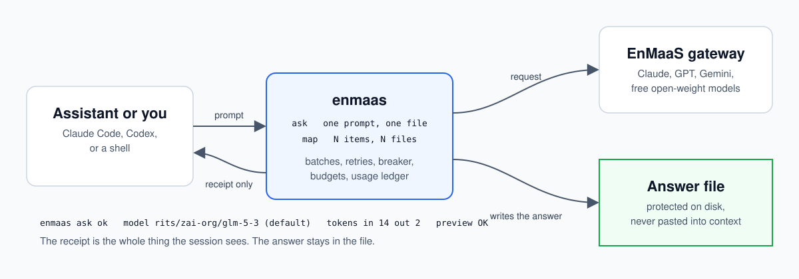
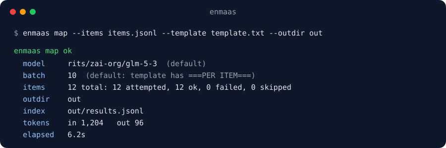
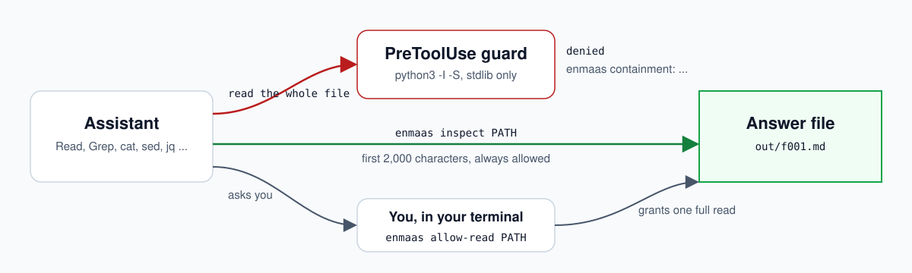

<p align="center">
  
</p>

<h1 align="center">enmaas</h1>

<p align="center">
  Delegate bulk and one-shot model work to the Red Hat EnMaaS gateway.<br>
  Answers go to files. Your assistant sees a receipt.
</p>

<p align="center">
  <a href="https://github.com/enmaas-cli/enmaas-cli/actions/workflows/check.yml"></a>
  
  
  
</p>

---

**enmaas** is a command line tool and an agent skill. You, or your coding
assistant, hand it work that is independent per item and needs no tool calls:
classify a few hundred findings, read a long document once, get a second opinion
from another model. It sends the work to a gateway that serves the OpenAI or
Anthropic API shape under `/v1`, writes each answer to a file, and prints a
short receipt. The full answer stays out of the conversation that asked for it.

- **Small context.** A long file is summarised without its text entering the
  session.
- **Cheap bulk work.** `enmaas map` sends items on their own, several at once.
  The default model is free.
- **A guard.** A hook for Claude Code and Codex denies what it recognizes as a
  read of a delegated answer.
- **A ledger.** `enmaas usage` shows what you spent. A token budget can refuse a
  run before it starts.

## What is new in 0.8.0

A hardening release. Keys and refused gateway URLs stay out of error text. New
state files are private. A bad reply keeps its charge, and a budgeted run stops
when the ledger is damaged. The guard recognizes more shell forms. Read the
[changelog](CHANGELOG.md), including its
[Known limits](CHANGELOG.md#known-limits), before you rely on the guard.

## Install

```bash
git clone https://github.com/enmaas-cli/enmaas-cli.git
cd enmaas-cli
./install.sh --gateway https://GATEWAY-HOST --key-file ~/.secrets/enmaas
```

The installer sets up the command, the gateway URL, the skill and the guard for
whichever of Claude Code and Codex it finds. Put your key in `~/.secrets/enmaas`
and run `enmaas models`. The [install guide](INSTALL.md) has every step.

From a Claude Code plugin marketplace that lists this repository:

```
/plugin install enmaas --marketplace <owner>/<repo>
```

The plugin provides the skill and the guard. Add the command separately:

```bash
./install.sh --cli-only --gateway https://GATEWAY-HOST
```

## Use

```bash
# One answer, written to a file
enmaas ask -f docs/reference.md -o /tmp/summary.md -p "Summarise this in ten bullet points."

# One answer file per item
printf '%s\n' '{"id": "a", "n": 7}' '{"id": "b", "n": 12}' > items.jsonl
printf 'Answer EVEN or ODD for each item.\n===PER ITEM===\nNUMBER: {n}\n' > template.txt
enmaas map --items items.jsonl --template template.txt --outdir out

enmaas inspect out/a.md          # a bounded preview
enmaas allow-read out/a.md       # you, in your terminal: grant a full read
enmaas usage --since 30          # what you have spent
```

<p align="center">
  
</p>

`-m MODEL` is optional. The built-in default, `rits/zai-org/glm-5-3`, is free.

## The output guard

<p align="center">
  
</p>

The guard denies what it recognizes as a read of a protected answer file,
through the hosts' file tools and the common shell readers. It allows a command
it does not recognize. It guards against accidental reads by a well-behaved
assistant. It is not a sandbox: an assistant that writes its own program to open
the file, or copies the file first, is outside what it checks. Coverage is in
[output protection](skills/enmaas/references/output-protection.md). Open gaps
are in [Known limits](CHANGELOG.md#known-limits).

## Documentation

| | |
|---|---|
| [Install guide](INSTALL.md) | Install, update, remove, troubleshoot |
| [Reference](docs/reference.md) | Every command, flag, config key and exit code |
| [Skill](skills/enmaas/SKILL.md) | What the assistant is told to delegate |
| [Output protection](skills/enmaas/references/output-protection.md) | What the guard covers |
| [Changelog](CHANGELOG.md) | What changed in each release, and known limits |
| [Contributing](CONTRIBUTING.md) | How changes land |
| [Security](SECURITY.md) | How to report a problem |

## Development

```bash
uv venv .venv && source .venv/bin/activate && uv pip install -e ".[dev]"
make check            # ruff, format, mypy strict, pytest
make check-install    # installs into a throwaway HOME and checks every step
make live             # free hosted models; needs ENMAAS_BASE_URL and a key
```

## License

Apache 2.0. See [LICENSE](LICENSE). Maintained by eparenti.
