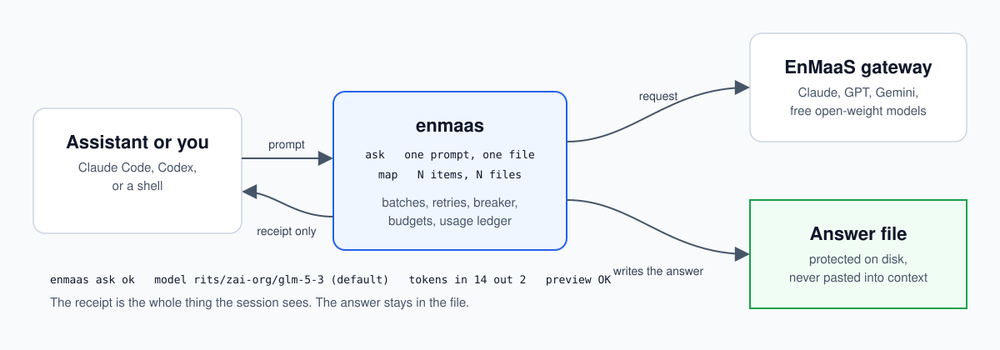
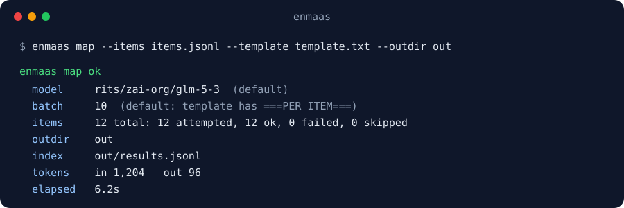
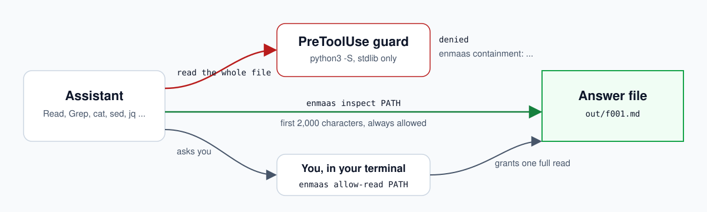

<p align="center">
  
</p>

<h1 align="center">enmaas</h1>

<p align="center">
  Delegate bulk and one-shot model work to the Red Hat EnMaaS gateway.<br>
  Answers go to files. Your assistant sees a receipt.
</p>

<p align="center">
  <a href="https://github.com/enmaas-cli/enmaas-cli/actions/workflows/check.yml"></a>
  
  
  
</p>

---

**enmaas** is a command line tool and an agent skill. You, or your coding
assistant, hand it work that is independent per item and needs no tool calls:
classify a few hundred findings, read a long document once, get a second opinion
from a different model family. It sends the work to EnMaaS, which hosts Claude,
GPT, Gemini and two free open-weight models behind one key, writes every answer
to a file, and prints a short receipt with a preview of at most 160 characters.
The full answer stays out of the conversation that asked for it. The gateway is
any endpoint that serves the OpenAI or Anthropic API shape under `/v1`; your
organization gives you its URL and your key.

## Why teams use it

| | |
|---|---|
| **Free where free is enough** | On an 80-item rule-checking task scored against ground truth, the free default model matched in-session Opus (98.8% accuracy) for 95% less. The cheapest paid Claude model did worse and cost more. Price does not order capability, so the tool measures and you choose. |
| **Context stays small** | A 150,000-token file is summarised without a token of it entering the session. Every later step is cheaper, because every tool call re-sends the whole conversation. |
| **Bulk without the multiplier** | When an assistant loops over a list, each item carries the entire conversation. `enmaas map` sends items on their own, several at once, and batches shared instructions. |
| **A guard, not a guideline** | A `PreToolUse` hook for Claude Code and Codex denies reading a delegated answer back. The assistant previews a bounded prefix; you decide when it may read the whole thing. |

One task class was measured. Treat the numbers as evidence to check against your
own work, and run `enmaas usage` to see what yours costs.

## Install

```bash
git clone https://github.com/enmaas-cli/enmaas-cli.git
cd enmaas-cli
./install.sh --gateway https://GATEWAY-HOST --key-file ~/.secrets/enmaas
```

The installer sets up the command, the gateway URL, the skill and the guard for
whichever of Claude Code and Codex it finds. Put your key in `~/.secrets/enmaas`,
run `enmaas models`, and you are done. The **[install guide](INSTALL.md)** has every
step, the host setup, and a troubleshooting table.

## Use

**Ask** once, answer to a file:

```bash
enmaas ask -f docs/reference.md -o /tmp/summary.md <<'PROMPT'
Summarise this reference in ten bullet points for someone who has never used the tool.
PROMPT
```

**Map** over many items, one answer file each. The `===PER ITEM===` line makes
`map` send the instructions once per group of ten:

```bash
printf '%s\n' '{"id": "a", "n": 7}' '{"id": "b", "n": 12}' '{"id": "c", "n": 31}' > items.jsonl
printf 'Answer EVEN or ODD for each item.\n===PER ITEM===\nNUMBER: {n}\n' > template.txt
enmaas map --items items.jsonl --template template.txt --outdir out
```

<p align="center">
  
</p>

**Look** at an answer without pulling it into an assistant, or let one read it:

```bash
enmaas inspect out/a.md          # first 2,000 characters
enmaas allow-read out/a.md       # you, in your terminal: grant a full read
enmaas usage --since 30          # what you have spent
```

`-m MODEL` is optional on `ask` and `map`. The built-in default,
`rits/zai-org/glm-5-3`, is free.

## The output guard

<p align="center">
  
</p>

Delegating saves little if the assistant reads the answer straight back. The
guard denies reads of protected answer files through the hosts' file tools and
the common shell readers, including through pipelines and globs. Receipts and
every other file stay readable. It runs with `python3 -S` from two
standard-library-only modules, so it needs nothing installed. The skill tells the
assistant to respect a denial and ask you instead. Coverage and limits are in
[output protection](skills/enmaas/references/output-protection.md).

## What the assistant is told

The skill gives Claude Code and Codex one rule: delegate when the work is
independent per item, needs no tool calls, and is useful as a file. Classify,
extract, rewrite, triage, summarise, second-opinion. Keep debugging, test-and-fix
loops, dependent steps and decisions in the session. Read it in
[SKILL.md](skills/enmaas/SKILL.md).

## Documentation

| | |
|---|---|
| [Install guide](INSTALL.md) | Clone to first delegation, update, remove, troubleshoot |
| [Reference](docs/reference.md) | Every command, flag, config key, exit code, and the budget and breaker rules |
| [Skill](skills/enmaas/SKILL.md) | What the assistant is told, and the delegate / do-not-delegate lists |
| [Output protection](skills/enmaas/references/output-protection.md) | Which files and tools the guard covers |
| [Changelog](CHANGELOG.md) | What changed in each release |
| [Contributing](CONTRIBUTING.md) | How changes land |
| [Security](SECURITY.md) | How to report a problem |

## Development

```bash
uv venv .venv && source .venv/bin/activate && uv pip install -e ".[dev]"
make check            # ruff, format, mypy strict, pytest
make check-install    # installs into a throwaway HOME and checks every step
make live             # free hosted models; export ENMAAS_BASE_URL and a key (ENMAAS_KEY or ~/.secrets/enmaas)
```

## License

Apache 2.0. See [LICENSE](LICENSE). Maintained by eparenti.
